# 🔊 Hệ Thống Phân Loại Âm Thanh: Live Voice vs Replay Attack (Fraud Audio Detection)

[](https://www.python.org/downloads/)
[](https://pytorch.org/)
[](https://streamlit.io/)
[](LICENSE)

Hệ thống bảo mật sinh trắc học giọng nói dựa trên Deep Learning nâng cao, chuyên biệt cho việc phát hiện gian lận âm thanh: Phân biệt **giọng người thật đang nói trực tiếp (Live Voice)** và **giọng ghi âm phát lại qua thiết bị loa (Replay Attack)**.


---

## 📋 Mục Lục

1. [Tổng Quan Bài Toán](#-tổng-quan-bài-toán)
2. [Báo Cáo Chi Tiết Cải Tiến Mô Hình](#-báo-cáo-chi-tiết-cải-tiến-mô-hình)
3. [Dữ Liệu Huấn Luyện & Tiền Xử Lý](#-dữ-liệu-huấn-luyện--tiền-xử-lý)
4. [Kết Quả Huấn Luyện & Đánh Giá](#-kết-quả-huấn-luyện--đánh-giá)
5. [Cấu Trúc Kiến Trúc Mạng (CRNN + Attention)](#-cấu-trúc-kiến-trúc-mạng-crnn--attention)
6. [Hướng Dẫn Cài Đặt & Sử Dụng](#-hướng-dẫn-cài-đặt--sử-dụng)
7. [Cấu Trúc Thư Mục Dự Án](#-cấu-trúc-thư-mục-dự-án)
8. [Định Hướng Phát Triển Tương Lai](#-định-hướng-phát-triển-tương-lai)

---

## 🎙️ Tổng Quan Bài Toán

Tấn công phát lại (**Replay Attack**) là một trong những hình thức gian lận phổ biến nhất đối với các hệ thống xác thực sinh trắc học giọng nói (Voice Biometrics) trong các ứng dụng tài chính, ngân hàng, eKYC và nhà thông minh. Kẻ gian thu âm giọng nói của người dùng hợp lệ, sau đó sử dụng thiết bị phát âm thanh (loa điện thoại, loa máy tính, loa Bluetooth) để giả mạo phiên xác thực.

Hệ thống phân loại bài toán thành 2 lớp:
- **Real (Nhãn `1` - Live Voice):** Tín hiệu giọng người thật nói trực tiếp vào micro.
- **Fake (Nhãn `0` - Replay Attack):** Tín hiệu âm thanh bị thu âm và phát lại qua loa.

---

## 🚀 Báo Cáo Chi Tiết Cải Tiến Mô Hình

### 1. Hạn Chế Của Các Mô Hình Cũ (Baseline / Classic Models)

Các giải pháp truyền thống (như 2D CNN cơ bản, MFCCs + SVM/Random Forest hay GMM-UBM) thường gặp các nhược điểm nghiêm trọng:
1. **Thiếu khả năng học chuỗi thời gian dài (Temporal Modeling):** Mạng CNN thuần túy chỉ trích xuất đặc trưng không gian (spatial features) trên từng vùng nhỏ của mảng quang phổ, làm mất đi tính phụ thuộc thời gian theo chuỗi của giọng nói.
2. **Nhạy cảm với nhiễu môi trường & âm lượng:** Dễ bị đánh lừa khi âm lượng đầu vào thay đổi hoặc khi thu âm trong môi trường có tiếng ồn background.
3. **Bỏ sót dấu vết Replay Artifacts:** Các vết tích của Replay Attack (như độ méo tần số của màng loa, độ vang phòng - Room Impulse Response) thường phân bố rải rác và không đồng đều trên miền thời gian. Puddle pooling hoặc Global Average Pooling đơn thuần làm suy giảm các dấu vết này.
4. **Không tương thích với nhiều định dạng âm thanh nén:** Mô hình cũ gặp lỗi crash khi người dùng tải lên các file âm thanh nén phổ biến từ điện thoại như `.m4a`, `.aac`, `.mp3`.

---

### 2. Các Cải Tiến Đột Phá Trong Mô Hình Mới (`CRNNWithAttn`)

| Hạng mục cải tiến | Giải pháp áp dụng | Lợi ích mang lại |
| :--- | :--- | :--- |
| **Backbone Trích Xuất Đặc Trưng** | Pre-trained **ResNet18** (ImageNet Weights) với chỉnh sửa Conv1 nhận 1 channel Mel-Spectrogram. | Khai thác khả năng trích xuất đặc trưng bậc cao từ thị giác máy tính, nhận diện sắc nét cấu trúc Mel-Spectrogram. |
| **Mô Hình Hóa Chuỗi Thời Gian** | **Bidirectional GRU (Bi-GRU)** 2 lớp (Hidden size: 128, tổng 256 dimensions). | Nắm bắt thông tin ngữ cảnh thời gian theo cả 2 chiều (tiến và lùi), học được nhịp điệu giọng nói và đáp ứng tần số loa. |
| **Cơ Chế Gom Tụ Trọng Số (Pooling)** | **Multi-Head Self-Attention Pooling** (4 Attention Heads). | Tự động gán trọng số tập trung (attention weights) vào các đoạn thời gian mang dấu vết replay rõ nhất thay vì cào bằng dữ liệu. |
| **Chuẩn Hóa Kép (Dual Standardization)** | **Per-instance Normalization** + **ImageNet Normalization**. | Triệt tiêu sự chênh lệch về độ lớn biên độ (amplitude/volume) giữa các thiết bị thu âm khác nhau. |
| **Bắn Kênh Âm Thanh (Channel Safety)** | Chuyển đổi bắt buộc về **Mono 1-Channel** qua phép tính trung bình kênh (`mean(dim=0)`). | Loại bỏ lỗi đường tắt (shortcut learning) khi mô hình học nhầm tính chất Stereo vs Mono giữa các file. |
| **Xử Lý File Tải Lên Đa Nền Tảng** | Module **AudioUtil Multi-backend Fallback** (`torchaudio` -> `ffmpeg backend` -> `librosa` -> `ffmpeg CLI conversion`). | Đảm bảo đọc thành công 100% tất cả các định dạng âm thanh (.wav, .flac, .mp3, .m4a, .aac, .ogg). |

---

## 📊 Dữ Liệu Huấn Luyện & Tiền Xử Lý

### 1. Phân Bố Tập Dữ Liệu (`data/`)

Dữ liệu huấn luyện hiện tại được phân chia cân bằng tuyệt đối giữa 2 class:

- **Total Samples:** 90 file âm thanh FLAC chất lượng cao.
- **Data Split:** 80% Train (**72 mẫu**) / 20% Validation (**18 mẫu**) (Class-balanced split theo seed `42`).
- **Lớp Real (`data/real`):** 45 file âm thanh giọng nói trực tiếp.
- **Lớp Fake (`data/fake`):** 45 file âm thanh phát lại qua thiết bị loa.

---

### 2. Pipeline Tiền Xử Lý & Tăng Cường Dữ Liệu (Data Augmentation)

Mỗi file âm thanh đầu vào được xử lý qua pipeline tiêu chuẩn:

```mermaid
flowchart LR
    A["Raw Audio File"] --> B["Multi-backend Load"]
    B --> C["Resample 16,000 Hz"]
    C --> D["Convert Mono 1-CH"]
    D --> E["Pad / Truncate 2.5s"]
    E --> F["Data Augmentation"]
    F --> G["Mel-Spectrogram (128 mels)"]
    G --> H["SpecAugment (Time/Freq Mask)"]
    H --> I["Dual Standardization"]
    I --> J["Input Tensor to Model"]
```



- **Tần số lấy mẫu (Sample Rate):** `16,000 Hz`.
- **Độ dài khung (Duration):** `2.5 seconds` (tương đương 40,000 samples).
- **Mel-Spectrogram Parameters:** `n_mels = 128`, `n_fft = 780`, `hop_length = 195`.
- **Tăng cường dữ liệu (Augmentation Strategies):**
  - **Time Shift:** Dịch chuyển thời gian ngẫu nhiên ($\le 20\%$).
  - **Gaussian Noise:** Thêm nhiễu trắng ngẫu nhiên ($SNR = 0.005 - 0.05$).
  - **Pitch Shift:** Thay đổi cao độ giọng nói ngẫu nhiên ($1 - 3$ semitones).
  - **SpecAugment:** Frequency Masking & Time Masking xóa ngẫu nhiên các vệt phổ tần số và thời gian nhằm chống học vẹt (overfitting).

---

## 📈 Kết Quả Huấn Luyện & Đánh Giá

Mô hình đã được huấn luyện trên phần cứng **Apple Silicon MPS (Metal Performance Shaders)** trong 20 Epochs với các thông số:
- **Optimizer:** `AdamW` (learning rate: $1\times 10^{-4}$, weight decay: $1\times 10^{-4}$)
- **Scheduler:** `CosineAnnealingLR`
- **Loss Function:** `BCEWithLogitsLoss`

### 1. Bảng Nhật Ký Huấn Luyện (Training Log Report)

| Epoch | Train Loss | Val Accuracy | Precision | Recall | F1-Score | Ghi chú |
| :---: | :---: | :---: | :---: | :---: | :---: | :--- |
| **01** | 0.6741 | 66.67% | 63.64% | 77.78% | 0.7000 | Phân kỳ khởi tạo ResNet |
| **02** | 0.5471 | 77.78% | 85.71% | 66.67% | 0.7500 | Mô hình bắt đầu hội tụ |
| **03** | 0.4636 | 88.89% | 100.00% | 77.78% | 0.8750 | Cải thiện đáng kể |
| **04** | 0.3974 | 94.44% | 90.00% | 100.00% | 0.9474 | Đạt độ chính xác >94% |
| **08** | 0.1748 | 94.44% | 100.00% | 88.89% | 0.9412 | Loss giảm nhanh |
| **12** | **0.1549** | **100.00%** | **100.00%** | **100.00%** | **1.0000** | 🏆 **Lưu Checkpoint Tốt Nhất** |
| **13** | 0.1436 | **100.00%** | **100.00%** | **100.00%** | **1.0000** | Duy trì ổn định |
| **15** | 0.1666 | **100.00%** | **100.00%** | **100.00%** | **1.0000** | Duy trì 100% Val Acc |
| **20** | 0.1087 | 94.44% | 100.00% | 88.89% | 0.9412 | Hoàn thành huấn luyện |

> [!IMPORTANT]
> Mô hình đã đạt **Validation Accuracy 100%**, **Precision 100%**, **Recall 100%** và **F1-Score 1.0000** tại Epoch 12 và lưu trọng số tối ưu nhất vào file [models/best_model10.pth](file:///Users/nguyendinhkhanh/Documents/GitHub/phu-khac-anh-dep-trai/models/best_model10.pth).

---

## 🏗️ Cấu Trúc Kiến Trúc Mạng (CRNN + Attention)

Mô hình [`CRNNWithAttn`](file:///Users/nguyendinhkhanh/Documents/GitHub/phu-khac-anh-dep-trai/src/models.py#L34-L86) bao gồm 4 khối chính:

```
Input Mel-Spectrogram: [B, 1, 128, T]
       │
       ▼
┌─────────────────────────────────────────┐
│ 1. ResNet18 Backbone (Feature Extractor)│  --> Chiều đầu ra: [B, 512, T']
└─────────────────────────────────────────┘
       │
       ▼
┌─────────────────────────────────────────┐
│ 2. Bidirectional GRU (Temporal Model)   │  --> Chiều đầu ra: [B, T', 256]
└─────────────────────────────────────────┘
       │
       ▼
┌─────────────────────────────────────────┐
│ 3. Multi-Head Self-Attention Pooling    │  --> Chiều đầu ra: [B, 256]
└─────────────────────────────────────────┘
       │
       ▼
┌─────────────────────────────────────────┐
│ 4. MLP Classifier Head                  │  --> Output Sigmoid Score: [B, 1]
└─────────────────────────────────────────┘
```

1. **Backbone (`resnet18`):** Chuyển đổi phổ Mel thành bản đồ đặc trưng kênh $512 \times F' \times T'$, sau đó thu gọn chiều tần số $F'$ bằng phép lấy trung bình.
2. **Bi-GRU (`nn.GRU`):** Mô hình hóa chuỗi thời gian $T'$ với 2 hướng (forward & backward), tổng hợp thông tin ngữ cảnh thời gian.
3. **Multi-Head Attention Pooling (`MultiHeadAttentionPool`):** Tính toán độ tương quan tự chú ý giữa các bước thời gian với 4 đầu chú ý (heads), giúp tập trung vào các đoạn biến đổi tần số cực nhỏ do loa gây ra.
4. **Classifier Head:** Gồm lớp Fully-Connected, Batch Normalization, Activation ReLU, Dropout ($0.3$) và lớp Linear cuối cùng để đưa ra điểm xác suất (Score $\ge 0.5 \rightarrow$ Live Voice, $< 0.5 \rightarrow$ Replay Attack).

---

## 💻 Hướng Dẫn Cài Đặt & Sử Dụng

### 1. Điều Kiện Tiên Quyết
- **Python:** `3.11` trở lên.
- **Quản lý gói:** `uv` (khuyên dùng) hoặc `pip`.
- **FFmpeg:** Được cài đặt trên hệ thống (để hỗ trợ xử lý file âm thanh nén `.m4a`, `.aac`).

### 2. Cài Đặt Môi Trường

```bash
# Clone repository
git clone https://github.com/mlvanguards/fraud-audio-detection.git
cd fraud-audio-detection

# Đồng bộ hóa môi trường ảo bằng uv
uv sync

# Kích hoạt môi trường ảo
source .venv/bin/activate
```

---

### 3. Chạy Ứng Dụng Web UI (Streamlit)

Khởi động ứng dụng phân loại trực quan trên trình duyệt:

```bash
.venv/bin/streamlit run src/main.py
```

Ứng dụng sẽ tự động mở giao diện tại địa chỉ `http://localhost:8501`. Người dùng có thể **ghi âm trực tiếp từ Micro** hoặc kéo thả file âm thanh (`.wav`, `.flac`, `.mp3`, `.m4a`, `.aac`, `.webm`) để xem ngay kết quả phân loại và điểm độ tin cậy.

---

### 4. Huấn Luyện Lại Mô Hình (Training)

Để chạy huấn luyện mô hình với dữ liệu trong thư mục `data/`:

```bash
# Huấn luyện fine-tune tiếp tục từ checkpoint hiện tại
.venv/bin/python src/training.py --epochs 20

# Huấn luyện mới từ đầu (Reset trọng số sạch từ ImageNet ResNet18)
.venv/bin/python src/training.py --epochs 20 --reset-model

# Tùy chỉnh tham số huấn luyện
.venv/bin/python src/training.py --data-dir data --model-path models/my_model.pth --epochs 15 --batch-size 16 --learning-rate 0.0001
```

---

### 5. Triển Khai Với Docker

Build và chạy ứng dụng bằng Docker Container:

```bash
# Build Docker image
docker build -t fraud-audio-detection .

# Chạy Docker container
docker run -p 8501:8501 --rm fraud-audio-detection
```

---

## 📁 Cấu Trúc Thư Mục Dự Án

```
phu-khac-anh-dep-trai/
├── data/                      # Thư mục dữ liệu huấn luyện
│   ├── fake/                  # Nhãn 0: Giọng ghi âm phát lại qua loa (Replay Attack)
│   └── real/                  # Nhãn 1: Giọng người thật nói trực tiếp (Live Voice)
├── models/                    # Lưu trữ các file trọng số mô hình (.pth)
│   └── best_model10.pth       # Model checkpoint đạt kết quả cao nhất
├── convert-data/              # Công cụ hỗ trợ chuyển đổi & tiền xử lý âm thanh
│   └── convert.py
├── src/                       # Mã nguồn chính của dự án
│   ├── main.py                # Giao diện Web Streamlit UI & Pipeline suy luận (Inference)
│   ├── models.py              # Định nghĩa kiến trúc CRNNWithAttn & Attention Pooling
│   ├── training.py            # Pipeline huấn luyện, Data Augmentation & Evaluation
│   └── util.py                # Helper utilities
├── images/                    # Sơ đồ & hình ảnh tài liệu
├── Dockerfile                 # File cấu hình đóng gói Docker Container
├── Makefile                   # Tự động hóa các lệnh build & test
├── pyproject.toml             # Cấu hình project dependencies (uv)
└── README.md                  # Báo cáo chi tiết & tài liệu hướng dẫn
```

---

## 🔮 Định Hướng Phát Triển Tương Lai

1. **Mở Rộng Dataset Đa Dạng Môi Trường:** Tích hợp bộ dữ liệu chuẩn quốc tế như **ASVspoof 2019/2021 Evaluation Set** để tăng khả năng tổng quát hóa trên nhiều dòng loa và micro khác nhau.
2. **Ứng Dụng Mô Hình Self-Supervised Learning (SSL):** Thử nghiệm tích hợp các thuật toán Pre-trained Audio Foundation Models như **Wav2Vec 2.0**, **HuBERT** hoặc **WavLM** làm backbone thay thế cho ResNet18.
3. **Phát Triển RESTful API Service:** Đóng gói mô hình thành dịch vụ API với **FastAPI** và **gRPC** để hỗ trợ tích hợp trực tiếp vào hệ thống eKYC / Tổng đài Ngân hàng thực tế.
4. **Tối Ưu Hóa Tốc Độ Suy Luận:** Export mô hình sang định dạng **ONNX Runtime** và **TensorRT** để đạt độ trễ suy luận $< 50\text{ms}$ trên môi trường Server/Edge.

---

## 📄 Giấy Phép

Dự án được cấp phép theo các điều khoản trong file [LICENSE](LICENSE) đính kèm repository.